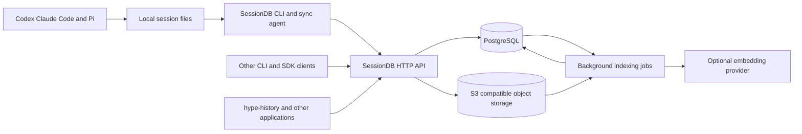
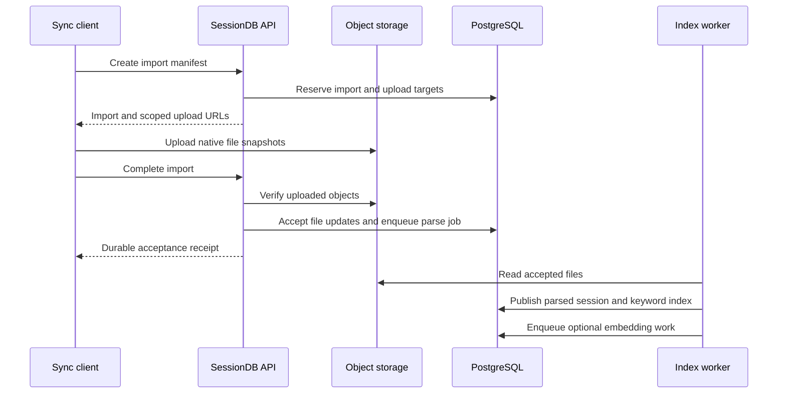

# Architecture

SessionDB uses a Rust server, a Rust CLI with an automatic sync mode, and a reusable Rust client SDK. The server owns session access and indexing; clients use the same HTTP contract that other applications use.

Status: proposed implementation of the agreed [product requirements](product.md).

## System boundary

PostgreSQL holds session data, search indexes, project metadata, access settings, and job state. Original files and large artifacts live in an existing S3-compatible object store. SessionDB uses its object API for storage and its own session API for queries.

## Rust workspace

Start with one Cargo workspace and these five packages when code implementation is authorized:

| Package | Purpose | Depends on |
| --- | --- | --- |
| `sessiondb-types` | Public resource/request/response types and API errors | Serialization and basic value types |
| `sessiondb-adapters` | Harness discovery metadata and native transcript normalization | Types; no server or database |
| `sessiondb-client` | Typed async HTTP SDK, authentication plumbing, pagination, and job access | Types and HTTP client |
| `sessiondb-cli` | `sessiondb` binary, interactive ergonomics, local collection state, and sync | Client, adapters, types |
| `sessiondb-server` | `sessiondb-server` binary, HTTP routes, authorization, persistence, search, and workers | Types, adapters, storage libraries |

Keep server concerns in modules initially: `api`, `auth`, `catalog`, `imports`, `objects`, `search`, `embeddings`, and `jobs`. Extract another crate only when there is a concrete reuse or dependency reason. The client must not depend on server internals.

The Rust 2024 edition and Cargo workspace conventions are the baseline. Lock versions and select a tested MSRV during the first implementation milestone. Shared DTOs do not replace a language-neutral HTTP contract.

## Candidate libraries

| Concern | Proposed starting point |
| --- | --- |
| Async runtime and HTTP service | Tokio, axum, tower/tower-http |
| JSON and typed resources | serde and serde_json |
| PostgreSQL and migrations | SQLx |
| HTTP client and embedding requests | reqwest with a shared connection pool |
| CLI and completions | clap and clap_complete |
| Blob access | Apache Arrow `object_store` or the AWS Rust SDK after the compatibility spike |
| Logs and request instrumentation | tracing and tracing-subscriber |
| API contract | Checked-in OpenAPI 3.1; Rust schema generation may verify it later |

These are library candidates, not pinned dependencies. In particular, evaluate presigned uploads, conditional operations, checksum behavior, and endpoint configuration before selecting the object client. Use Rust traits for harness adapters, object access, and embedding providers; a runtime plugin loading system is unnecessary for the first release.

## Server execution model

Deploy one service with a bounded API runtime and background workers. PostgreSQL persists job leases, attempts, retry times, and results. A worker claims a job transactionally and refreshes its lease; an expired lease permits retry after a process dies. Do not hold a database transaction during network uploads or embedding calls.

The same binary may later run API-only or worker-only modes. This is an extraction path, not a requirement to deploy several services initially. Parsing and embedding have separate queues/concurrency limits so an unavailable model endpoint does not block session collection.

## Import sequence

An object upload alone is not an accepted import. An accepted import can exist before a searchable projection. A database commit and S3 write are not one distributed transaction: upload and verify first, then commit the catalog and job. Unreferenced staging objects are cleaned after a documented grace period.

## Consistency

Catalog and membership reads use PostgreSQL. Session parsing, keyword indexing, and embedding are asynchronous. Responses include processing state so users can distinguish collection lag from search lag. Keyword results cover indexed accepted content; embedding coverage is a separate measure.

The [sync protocol](sync.md) specifies retries and rewrites. The [data model](data-model.md) separates conversation branches from nested execution. All read paths apply [project authorization](access-control.md) before returning content, including search candidates and raw export access.

## API and applications

The HTTP API is the interoperability boundary. The CLI and Rust SDK use it; other SDKs can be generated from OpenAPI. hype-history becomes an application client. Its research packet and reviewed-memory rules do not become implicit server behavior.

S3 storage access, native transcript syntax, and standardized exports are different interfaces. Use [the format integration rules](integrations.md) when adding export support. Do not infer S3 compatibility from ordinary JSON endpoints.
