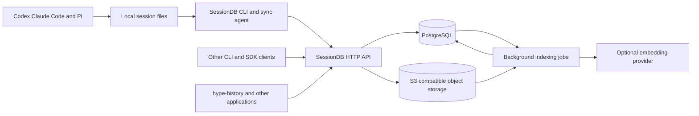
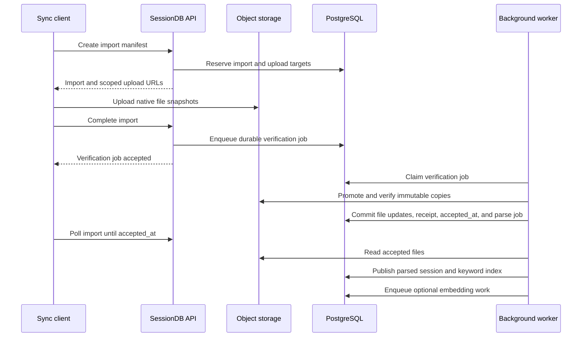

# Architecture

SessionDB consists of a server, a CLI with an automatic sync mode, and a reusable client SDK. The server owns session access and indexing; clients use the same HTTP contract that other applications use.

Status: accepted first-build architecture. The [selected scope](first-build.md) implements the agreed product direction incrementally.

## System boundary

PostgreSQL holds session data, search indexes, optional project metadata, session access settings, and job state. Original files and large artifacts live in an existing S3-compatible object store. SessionDB uses its object API for storage and its own session API for queries.

## Rust workspace

Start with one Cargo workspace and these five packages when code implementation is authorized:

| Package | Purpose | Depends on |
| --- | --- | --- |
| `sessiondb-types` | Public resource/request/response types and API errors | Serialization and basic value types |
| `sessiondb-adapters` | Harness discovery metadata and native transcript normalization | Types; no server or database |
| `sessiondb-client` | Typed async HTTP SDK, authentication plumbing, pagination, and job access | Types and HTTP client |
| `sessiondb-cli` | `sessiondb` binary, interactive ergonomics, local collection state, and sync | Client, adapters, types |
| `sessiondb-server` | `sessiondb-server` binary, HTTP routes, authorization, persistence, search, and workers | Types, adapters, storage libraries |

Keep server concerns in modules initially: `api`, `auth`, `catalog`, `imports`, `objects`, `search`, `embeddings`, and `jobs`. Extract another crate only when there is a concrete reuse or dependency reason. The client must not depend on server internals.

The Rust 2024 edition and Cargo workspace conventions are the baseline. Commit the pinned toolchain and dependency lockfile during the first implementation milestone using the tested baseline below. Shared DTOs do not replace a language-neutral HTTP contract.

## Implementation baseline

Use Tokio/axum, serde, SQLx, reqwest, clap, the official AWS S3 client, and structured tracing. Use openidconnect for the CLI login protocol and jsonwebtoken for the API's JWT profile. The selected versions and successful dependency/protocol checks are recorded in [reference validation](validation/reference-stack.md).

The initial tested compiler baseline is Rust 1.94.1 with the Rust 2024 edition. The first application commit supplies the actual workspace Cargo.lock and pinned toolchain. Use the library versions from the tested baseline rather than choosing new latest versions independently.

Harness adapters, blob access, and embedding providers have focused Rust interfaces. The first blob implementation uses `aws-sdk-s3` 1.159.0 with explicit path-style/endpoint/region/checksum settings and pinned behavior version `v2026_11_10`. SeaweedFS 4.54 is the reference self-hosted service; compatible existing S3 services use the same checks. The OpenAPI contract remains the language-neutral interface.

## Server execution model

Deploy one service with a bounded API runtime and background workers. PostgreSQL persists job leases, attempts, retry times, and results. A worker claims a job transactionally and refreshes its lease; an expired lease permits retry after a process dies. Do not hold a database transaction during network uploads or embedding calls.

The same binary may later run API-only or worker-only modes. This is an extraction path, not a requirement to deploy several services initially. Parsing and embedding have separate queues/concurrency limits so an unavailable model endpoint does not block session collection.

## Import sequence

An upload or scheduled completion is not archival acceptance. A background verifier promotes staging bytes to immutable keys, verifies the promoted copies, and commits the receipt before parsing. The client advances only after `accepted_at` is set. PostgreSQL and S3 are not one transaction; reserved unreferenced objects are cleaned according to the documented lease/grace policy.

## Consistency

Catalog and membership reads use PostgreSQL. Session parsing, keyword indexing, and embedding are asynchronous. Responses include processing state so users can distinguish collection lag from search lag. Keyword results cover indexed accepted content; embedding coverage is a separate measure.

The [sync protocol](sync.md) specifies retries and rewrites. The [data model](data-model.md) separates conversation branches from nested execution. All read paths apply [session authorization](access-control.md) before returning content, including search candidates and raw export access.

## API and applications

The HTTP API is the interoperability boundary. The CLI and SDK use it; other SDKs can be generated from OpenAPI. hype-history becomes an application client. Its research packet and reviewed-memory rules do not become implicit server behavior.

S3 storage access, native transcript syntax, and standardized exports are different interfaces. Use [the format integration rules](integrations.md) when adding export support. Do not infer S3 compatibility from ordinary JSON endpoints.
