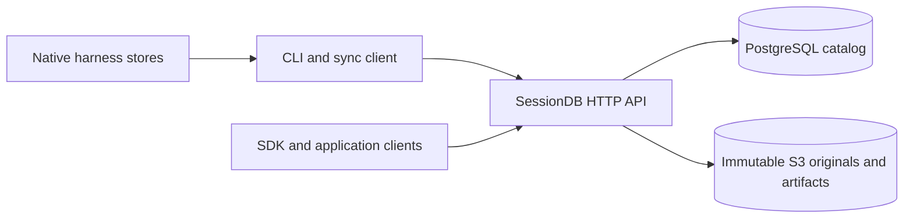

# Architecture

SessionDB consists of a server, a CLI with automatic sync, and a reusable async client SDK. Sessions contain messages/events/artifacts; sources explain file provenance and projects optionally classify sessions.

Status: accepted first-build architecture, revised by [ADR 0014](decisions/0014-sessions-and-synchronous-files.md).

## System boundary

Clients send one bounded native file through the API, not directly to S3. PostgreSQL holds explicit session/message/event metadata and typed content; immutable original/artifact bytes live in an existing S3-compatible store. Search and embedding providers remain planned extensions, not prerequisites for collection.

## Rust workspace

| Package | Purpose |
| --- | --- |
| `sessiondb-types` | Public transport-independent resources, requests, responses, and errors. |
| `sessiondb-adapters` | Harness discovery metadata and native normalization, without server/database dependencies. |
| `sessiondb-client` | Typed async HTTP, bearer authentication, multipart upload, pagination, and downloads. |
| `sessiondb-cli` | Human/machine output, server URL selection, local snapshots/checkpoints, one-shot and watch sync. |
| `sessiondb-server` | HTTP, key verification, per-file ingestion, catalog reads, immutable object storage, orphan cleanup. |

Use focused server modules rather than another framework or compatibility layer. Shared DTOs do not replace [OpenAPI](openapi.yaml); SDK callers do not depend on internal server structs.

The locked baseline uses Rust 2024/Rust 1.94.1, Tokio/axum, serde, SQLx, reqwest, clap, tracing, and the official AWS S3 client. SeaweedFS 4.54 and `aws-sdk-s3` 1.159.0 with behavior version `v2026_11_10` are the reference pair. [Reference validation](validation/reference-stack.md) records historical compatibility experiments, not proof of this redesign.

## Request execution

1. Authenticate with the required instance key and validate exactly one metadata/file pair.
2. Verify actual length and digest; detect already accepted identical content.
3. Fully parse every supplied record before registering fresh object keys or uploading immutable original/artifact bytes.
4. Recheck optimistic file version and publish file, generation, sessions, messages, events, and artifacts in one PostgreSQL transaction.
5. Return HTTP 200 with the accepted file, related session IDs, and unchanged flag.

S3 I/O is outside catalog transactions. Concurrent conflicting publication returns `409`; a disconnect can be retried from the saved snapshot. Unsupported or malformed files reject with HTTP 400 before any storage/catalog mutation. There is no persisted upload state, batch reservation, verification queue, worker lease, or parse polling.

Each request is individually accepted; multiple files have no shared atomicity guarantee. The client checkpoints each successful receipt. Appends retain generation identity after full-prefix verification; rewrites retain older generations.

## Consistency and cleanup

Read handlers map explicit catalog columns. Full message content is persisted once; previews/URLs are computed at read time. Native branches, subagents, inherited files, known structural metadata, artifact bytes, ranges, and ZIP exports remain available; unknown native kinds reject the file.

Periodic orphan cleanup removes only unreferenced old object metadata transactionally, then deletes corresponding S3 keys outside the transaction. Foreign keys protect publication and never-reused keys protect against delayed deletion. This is not a generic task/workflow subsystem.

The eleven domain tables originate in immutable `0001_catalog.sql`. Athena is deployed, so subsequent schema/data repairs use forward migrations without old protocol aliases or state resets. All `/v1` resources use one shared key and all key holders see the same collection.

## Applications and future retrieval

The HTTP API is the interoperability boundary. hype-history and other applications own their own briefing, research, and reviewed-memory behavior.

Keyword search, embedding profiles/providers, hybrid retrieval, projects administration, and changes are planned as marked in OpenAPI. Their execution/backfill mechanism is not an active index-job API. Storage, sync, and reads must remain useful without a model endpoint.
