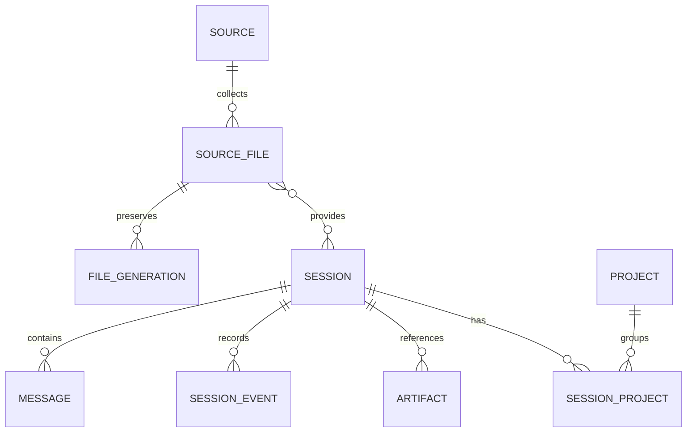

# Data model

Sessions are the primary records. Messages, tool calls, events, and artifacts describe their contents. Sources describe where native files are collected. Projects provide optional grouping independently of collection and access.

Status: proposed logical schema, incorporating [the session-first design](decisions/0008-collection-and-project-associations.md). This is not a database migration.

## Session model

A source file can contribute records to a session, and a session can depend on several files or related sessions. A session can have no project associations or several. Native copies and inherited history remain distinguishable in the catalog.

## Resources

| Resource | Main fields and behavior |
| --- | --- |
| Session | Harness/native ID, title, tags, `project_ids`, recorded cwd, start/activity times, source links, and processing state. |
| Message | Session, canonical/native role, origin, typed content, revision, recorded time, sequence, native references, and optional conversation parent. |
| Tool call | Call ID/name, explicitly JSON or text input, source message, and linked result when available; links are scoped to the originating session/source. |
| Session event | Compaction, model change, context edit, branch marker, or another recorded event, retaining native type and source reference. |
| Session relation | Parent/child, fork, delegation, or inherited-context reference, with an explicit resolution state. |
| Artifact | File/image/large content reference, media type, size, and instance-key-protected content. |
| Source | Device label, harness, native store root, and last successful sync. No project binding. |
| Project | ID, slug, name, optional repository URLs and status `active` or `archived`. A logical label within the instance. |
| Session project | A unique session/project association. Changing it does not change native files or instance access. |
| Job | Kind, optional source/session/project filters, state, progress, attempts, timestamps, and bounded errors. |

## Collection and directory metadata

Sources identify configured harness session stores, such as `~/.codex/sessions`. The recorded starting cwd is an attribute of a session, not its collection boundary or project identity. A session started in `/home/ada` can work on Payments in `/home/ada/work/payments` and later be assigned that project.

Native IDs help identify sessions within a harness, but do not replace source bindings. Claude subagents can repeat their parent's native session ID. Copies from different sources may differ, and divergent files are not silently combined.

An imported file may identify no session yet, one session, or inherited records. Archive the file and report parsing state independently. Unknown native formats remain retrievable by any correct-key client even before a session can be normalized.

Source IDs, device labels, native paths, and harness metadata retain provenance, not a caller identity or ownership claim. Native user-role data can be tool output or injected context; wire role does not prove human authorship.

## Project associations

`project_ids` is always an array; `[]` means unassigned. `PATCH` with a replacement array sets associations, omission preserves them, and an empty array clears them. Multiple project matches are valid.

Explicit configured rules may supply initial associations at first import. A nonmatch never blocks collection. Later sync updates recorded content but does not reset project labels or title/tags chosen in the catalog. Repository metadata and referenced paths can provide suggestions without becoming authoritative classification.

Projects are searchable grouping metadata, not security containers. Every key holder can list their names and query the same shared collection. See [project associations](project-associations.md).

## Messages and events

Content is a typed list of text, available reasoning, tool call, tool result, structured JSON, artifact reference, and unknown/native blocks. [Normalized content](normalized-content.md) defines the schemas and provider rules. Missing reasoning or timestamps remain unknown. Unknown blocks retain native type and opaque data, with message references locating the original records.

Conversation ancestry and operation nesting are separate fields. `conversation_parent_id` describes branching. A delegated operation or tool invocation has its own relationship; adjacent timestamps alone do not establish it.

The default message endpoint returns historical records in deterministic recorded order, including alternate branches. `leaf_id` selects a known message's ancestry. Compaction and context edits remain structural events; v1 does not promise exact provider-request reconstruction or deterministic replay.

The API returns bounded previews with `truncated` and a content URL where needed. Full normalized content and native export provide separate expansion paths.

## Original files

A source-relative file has accepted generations, each with a current immutable object reference, complete byte length, digest, and collection time. Verified prefix growth advances that generation; a rewrite preserves the preceding generation and starts another.

Source references address original uncompressed line/byte ranges. A newer verified append includes earlier referenced ranges. Old append snapshots can be collected once no explicit pin/export needs them; rewrite generations follow retention policy. See [sync](sync.md) and [operations](operations.md).

Source roots, unparsed files, and linked native dependencies are accessible to all correct-key clients. Files need no per-session authorization partition; missing dependencies remain explicit.

## Shared access

A single nonempty instance API key protects all data. There are no identity tables, owner fields, visibility, memberships, or grants in the active model. Every key holder has full access; projects only classify sessions. See [access control](access-control.md).

## Storage and deletion

Use PostgreSQL foreign keys, uniqueness constraints, UTC timestamps and transactional changes. Public IDs are opaque UUIDs; native IDs remain strings. Provider-specific fields remain native metadata rather than becoming top-level fields for every harness.

Archiving a project stops new associations to that label. It does not stop source collection, delete sessions, or remove existing associations. Any key holder can use implemented session deletion: it disappears from queries immediately and cleanup removes derived content and exclusively referenced objects asynchronously.

Deletion suppresses its existing source bindings so ordinary sync does not recreate it. The client receives a `suppressed` receipt and leaves the native local file intact. Restore/reimport requires a separate explicit contract.
