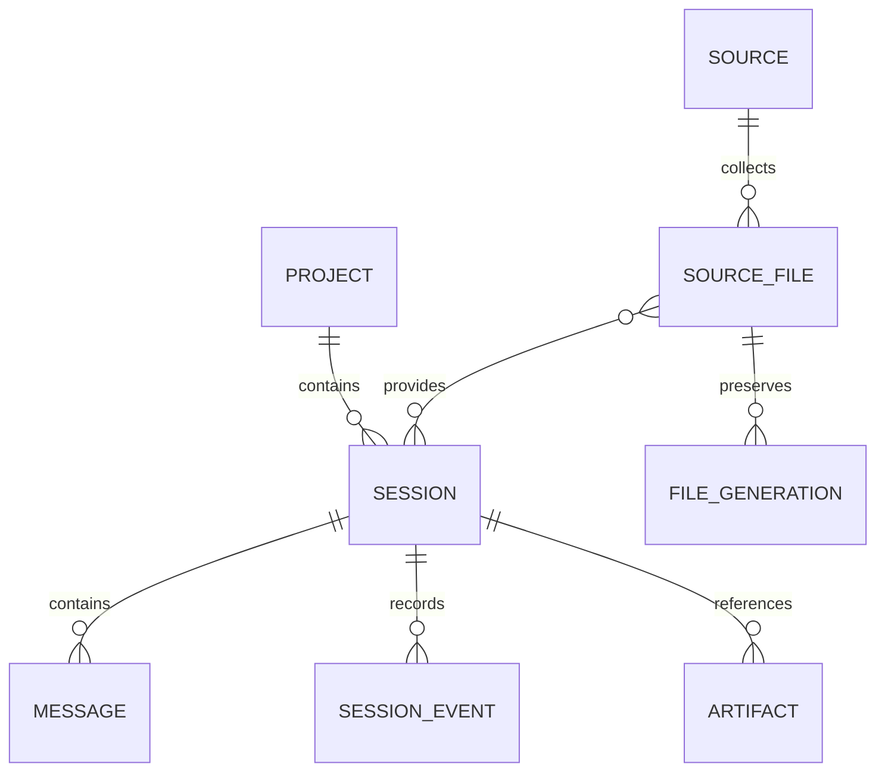

# Data model

The main resources are sessions, messages, tool calls, events, and artifacts. Collection sources connect native files to those resources; projects group related sessions. Access settings scope their use on a shared server.

Status: proposed logical schema. This is not a database migration.

## Session model

A source file can contribute records to a session, and a session can depend on several files or related sessions. Native copies and inherited history remain distinguishable in the catalog.

## Resources

| Resource | Main fields and behavior |
| --- | --- |
| Session | Organization, project, author attribution, harness/native ID, title, tags, recorded cwd, start/activity times, source links, processing state. |
| Message | Session, role, content blocks, recorded time, sequence, native reference, optional conversation parent. |
| Tool call | Call ID/name/arguments, source message, linked result when available; links are scoped to the originating session/source. |
| Session event | Compaction, model change, context edit, branch marker, or another recorded event, retaining native type and source reference. |
| Session relation | Parent/child, fork, delegation, or inherited-context reference. Relation type and resolution state are explicit. |
| Artifact | File/image/large content reference, media type, size, and project authorization inherited from the session. |
| Source | Project, registering account, device label, harness, workspace mapping, and last successful sync. One source belongs to one project and harness. |
| Project | ID, slug, name, optional repository URLs, status `active` or `archived`, and access scope. |
| Job | Organization/project, kind, state, progress, attempts, timestamps, and bounded error information. |

## Sessions and collection

Native IDs help identify a session within a harness, but are not the only storage key. Claude subagents can repeat their parent's native session ID. Copies collected from different sources may differ. The catalog keeps source bindings separate and records copies rather than silently combining divergent files.

An imported file may identify no session yet, one session, or records inherited from another session. Preserve that file and report parsing state independently. A parser that cannot understand a native version does not cause the uploaded file to disappear.

V1 project assignment comes from a configured source/workspace binding. The server validates it against the caller's project permissions. A cwd or repository URL inside untrusted transcript content cannot assign data to another project. Project remapping of existing sessions is an explicit future operation; changing local configuration does not move previously shared history.

The contributor is the account that registered the source. This is distinct from the native wire role of a message. Preserve native `user`, `assistant`, `system`, and `tool` semantics without treating all user-role content as human-authored.

## Message representation

Content is a typed list of text, available thinking/reasoning, tool call, tool result, image/artifact reference, and unknown/native blocks. Do not fabricate hidden reasoning or missing timestamps. Unknown blocks retain their native type and a raw source pointer.

Conversation ancestry and operation nesting are separate fields. `conversation_parent_id` describes branching. A tool invocation or delegated operation has its own relationship; it is not inferred solely from physical line order or an adjacent timestamp.

The default message endpoint returns historical records in deterministic recorded order, including alternate branches. A `leaf_id` filter selects the ancestry of a known message. Structural context edits and compaction remain events; v1 does not promise reconstruction of an exact provider request or deterministic replay.

The API exposes bounded content previews with `truncated` and a content URL when necessary. A dedicated content endpoint returns the full normalized content; native export returns the original representation. Never silently truncate without a visible indication.

## Original files

`source_files` associate an organization/source and relative native path with accepted file generations. A generation has a current immutable object reference, complete byte length, digest, and collection time. Ordinary verified prefix growth advances that generation; a rewrite starts another generation and keeps the preceding one.

Source references use a file generation and line/byte range in the original uncompressed byte space. A newer verified append still contains an earlier referenced range. Old append snapshots may be collected once nothing requires them; rewrite generations remain subject to explicit retention policy. See [sync](sync.md) for publication and [operations](operations.md) for retention.

## Database conventions

Use PostgreSQL foreign keys, explicit organization ownership, database uniqueness constraints, UTC timestamps, and transactional changes. Use UUID resource IDs in the HTTP API; native IDs remain strings. Slugs are convenient CLI lookup keys, not authorization boundaries.

Public resources do not expose internal SQL columns by default. Preserve provider extensions in structured native metadata without making every provider field a top-level SessionDB field. Parser versions and embedding profiles support rebuilding derived indexes.

## Shared access

Organizations scope a server's collections and account membership. User/team grants assign project access. Teams can access several projects, and projects can be shared by several teams.

| Resource | Purpose |
| --- | --- |
| Organization | ID, slug, display name, and settings; scopes projects and memberships. |
| User | ID and identity-provider issuer/subject, plus display attributes. |
| Membership | User membership in an organization, role, and status. |
| Team | A named group of active memberships. |
| Project grant | A project's user/team principal and access role. |

See [access control](access-control.md) for role behavior and administration.

## Deletion and archive state

Archiving a project stops new imports while retaining readable history. A project maintainer can delete a session through a deletion job: it becomes hidden from queries immediately, then its derived data and exclusively referenced objects are removed asynchronously. Shared objects are retained while another authorized resource still references them.

A session deletion creates a suppression entry for its existing source bindings. Ordinary sync does not resurrect it. The client receives an acknowledged `suppressed` result; it does not delete the local harness file. Explicit restore/reimport semantics must be specified before such a command is added.
